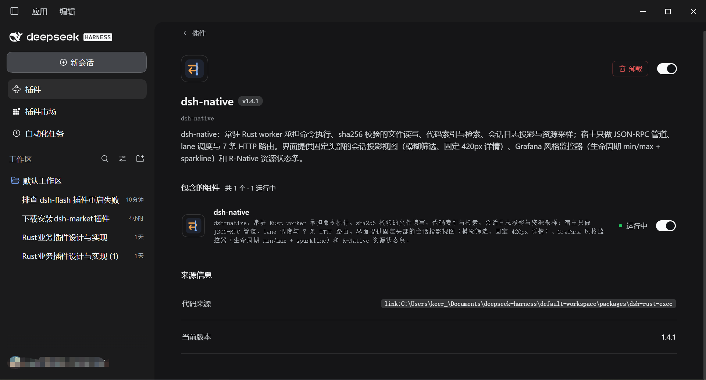
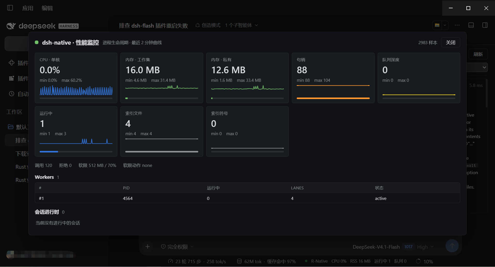

<p align="center">
  
</p>

<h1 align="center"></h1>

<p align="center"><code>a resident Rust sidecar for DeepSeek Harness</code></p>

<p align="center">
  
  
  
  
  
</p>

<hr>

把 DSH 里「真正动手」的那部分交给一个**常驻的 Rust worker**：命令执行、带 sha256 校验的文件读写、代码索引与检索、会话日志投影、资源采样都在 Rust 侧完成；DSH 宿主只做 JSON-RPC 管道、lane 调度与路由注册，浏览器侧只做**叠加式**展示。

- **11 个工具**：10 个 `rust_*` 加 `native_help`（5 个常驻、6 个按需激活）
- **8 条 HTTP 路由**：`/api/dsh-rust-exec/*`
- **三处界面**：固定头部的会话投影视图、Grafana 风格监控器、输入框下沿的 `dsh-rust-exec` 资源状态条

为什么值得装：

1. **每次工具调用都新起进程太贵。** DSH 每调一次 `pwsh` 要付一次 PowerShell 冷启动（本机 2.4–4.4 s，低完整性沙箱下更慢）。这里改成常驻 worker + 常驻 shell server，同一 lane 上后续命令是毫秒级。
2. **大输出、大文件、大日志把上下文吃光。** 读文件按行区间、搜索按字节预算裁剪、会话日志先解码当前页——同召回下返回体积约降 80%。
3. **看不见运行状态。** worker 重启次数、队列堵没堵、RSS 涨到哪、哪个会话在跑，全部进 `/metrics`、`rust_health` 和监控器。

<p align="center">
  
  <br>
  <sub><b>① 介绍</b> — 设置页里的插件条目、版本与资源监控入口</sub>
</p>

<p align="center">
  
  <br>
  <sub><b>② 视图页</b> — 固定头部（计数、模糊筛选、类别下拉、监控器/刷新）+ 左侧消息列表 + 固定 420 px 详情</sub>
</p>

<p align="center">
  
  <br>
  <sub><b>③ 监控页</b> — 三行卡片（Workers / Sessions / Cache）+ 跟随选中 worker 的曲线组 + 节省报表</sub>
</p>

---

## 安装

### 从 npm（推荐）

```powershell
# 1) 装进 DSH profile
pnpm add dsh-rust-exec     # 或 npm i dsh-rust-exec

# 2) 挂载 bundle —— 编辑 <DSH_HOME>\profiles\<profile>\package.json
#    "dsh": { "profile": { "bundles": [
#        "@deepseek-ai/dsh-base", "@deepseek-ai/dsh-web-app", "dsh-rust-exec" ] } }

# 3) 重启 DSH，然后验收
curl http://127.0.0.1:<port>/api/dsh-rust-exec/health
```

`ok: true`、worker pid、`routes: 8` 都在，就算装好了。随后设置页 → 插件 → `dsh-rust-exec` 会出现「监控器」按钮，对话页顶部会多出 `dsh-rust-exec` 页签。

> 1.7.6 起包名是 **`dsh-rust-exec`**（1.7.0–1.7.5 叫 `dsh-native`，更早是 `@keer1024/dsh-native`）。升级时 `dependencies` 的键与 `dsh.profile.bundles` 里的旧名要一起改，再 `pnpm install` + 重启；细节见 [包名迁移](docs/rust-exec-plugin/PACKAGE_RENAME_1.7.0.md) 与 [1.7.6 任务单](docs/tasks/1.7.6.md)。

### 从 tarball（离线 / 内网）

仓库根目录的 `bin/` 里始终放着**当前版本**的安装包（随仓库提交，带 `.sha256`）：

```powershell
# 先校验（可选但推荐）
Get-FileHash .\bin\dsh-rust-exec-1.7.6.tgz -Algorithm SHA256
# 与 bin\dsh-rust-exec-1.7.6.tgz.sha256 里的摘要比对

npm i .\bin\dsh-rust-exec-1.7.6.tgz
```

目标机要求、profile 两处改动、SmartScreen 与常见失败见 [分发与跨机安装](docs/rust-exec-plugin/DISTRIBUTION.md)。

### 从 GitHub 源码（不发 npm 时的备选）

```powershell
dsh plugin --profile web add github:keer1024/dsh-native#path:/packages/dsh-rust-exec
```

子包没有构建脚本，也不需要 `allowBuilds` 授权；代价是首次要拉整个仓库，比 npm / tarball 慢。

### 升级与卸载

- **升级**：`pnpm add dsh-rust-exec@latest` → 重启 DSH。
- **卸载**：在 DSH 插件管理里移除，或从 `dsh.profile.bundles` 删掉该条目 → 重启 DSH；投影缓存可整体删除，不残留状态。

装好后 host 侧（工具、路由）热生效；客户端叠加物需要**刷新一次页面**。

---

## 工具（11 个）

| 工具 | 作用 | 主要参数 |
|---|---|---|
| `rust_exec` | 在常驻 PowerShell lane 上执行命令；返回 `exitCode/stdout/stderr/ms/shellMs/queueMs/lane/reused` | `command`（必填）、`cwd`（持久化到后续调用）、`timeoutMs`、`queueTimeoutMs`（默认 30000） |
| `rust_read` | 读文件，按行区间取，返回 `sha256` 与总行数；同一文件同一区间的重复读会去重 | `path`、`offset`（1 起）、`limit`、`refresh` |
| `rust_write` | 原子写（临时文件 + rename），可选版本守卫 | `path`、`content`、`expectedHash`（sha256 或 `absent`） |
| `rust_edit` | 精确文本替换，锚点有歧义时失败且不改文件 | `path`、`oldString`、`newString`、`replaceAll` |
| `rust_stat` | 原生 stat：大小、时间、类型；`paths` 形态一次往返探测多个路径 | `path` 或 `paths: string[]`（≤256） |
| `rust_ls` | 目录列举，可限条数；`sizes:false` 省掉逐条 metadata | `path`、`limit`、`sizes` |
| `rust_search` | 常驻索引上的文本/正则检索，按字节预算与相关度裁剪 | `query`、`glob`、`regex`、`symbolsOnly`、`contextLines`（0–2）、`maxHits`（默认 24）、`maxBytes`（默认 6000）、`refresh` |
| `rust_symbols` | 符号检索（fn/class/struct/trait…），返回定义位置 | `query`、`path`、`kind`、`limit`（默认 40）、`maxBytes`、`refresh` |
| `rust_session_open` | 直接解 `session.v*.jsonl.zstd`，游标分页，首屏只解码当前页 | `path`、`limit`（1–500，默认 50）、`cursor`、`refresh` |
| `rust_health` | worker 存活、心跳间隙 p50/p99、重启次数、最后退出码、索引规模、路由挂载 | 无 |
| `native_help` | 渐进披露入口：列出尚未激活的工具，并在同一会话内激活它们 | `tools?: string[]` |

默认只常驻 `rust_exec` / `rust_read` / `rust_search` / `rust_health` / `native_help` 五个，其余 6 个由 `native_help` 按需激活（`progressiveDisclosure: false` 可恢复 11 个全常驻）。

统一截断契约：被裁剪的结果在 footer 带 `truncated by lines|bytes · omitted N · complete=false`，完整结果显示 `complete`，便于模型判断要不要续读。

## HTTP 路由（8 条）

前缀 `/api/dsh-rust-exec`，挂载失败会退避重试，挂载结果见 `/health` 的 `routes.registered`。

| 路由 | 返回 |
|---|---|
| `GET /metrics` | 采样（1 s 一点）、`pool`、`sessions`、`config`、`readiness`、`workers[]`、`cache`、`savings`、`extremes` |
| `GET /cache` | 读缓存与索引视图（entries/hits/bytes/ttl、files/symbols/buildMs） |
| `GET /health` | `hostPid`、worker pid/版本/协议、重启次数、`routes.registered`、锁文件路径 |
| `GET /events` | 近期事件环形缓冲（重启、软限、路由重挂等） |
| `GET /sessions` | 可投影的会话列表（≤50，按 mtime 倒序） |
| `GET /session?id=&limit=&cursor=` | 单个会话的分页投影（`mode=append/warm/head`、耗时分解） |
| `GET /session/body?id=&seqs=&maxChars=` | 指定 seq 的消息正文（最多 40 个 seq，缺 `seqs` → 400） |
| `POST /config` | 热改配置：6 个池键（`maxWorkers`/`maxShells`/`maxInFlightPerSession`/`idleReapMs`/`rssSoftLimitMb`/`cpuSoftLimitPct`）+ 5 个功能开关（`progressiveDisclosure`/`compactReads`/`prewarmIndex`/`deferStart`/`startDelayMs`）；返回 `applied`/`switches`/`requiresReload` |

浏览器带会话凭据，Node 侧直接 `fetch` 会拿到 401。

## 配置

Loader 行的 `config` 由 `Config['~standard'].validate` 校验，非法值直接拒绝挂载；`POST /config` 可热改一部分。设置页覆盖下表标 ✔ 的 11 个键：点 Apply 后立即写进 `%LOCALAPPDATA%\dsh-rust-exec\settings.json`（原子写，temp + rename），重启时自动读回；loader 里显式写了同一个键时以 loader 为准，所以想在机器上锁死某项，就写在 loader 行而不是设置页。

| 键 | 范围 / 默认 | 设置页 | 生效 | 说明 |
|---|---|---|---|---|
| `workerPath` | 默认包内 `bin/dsh-rust-worker.exe` | — | 重启 | 跨机部署路径不同时必须显式配 |
| `defaultTimeoutMs` | >0，默认 60000 | — | 重启 | 单次调用默认超时 |
| `lanes` | 1–16，默认 `min(4, cores/2)` | — | 重启 | 每个 worker 的并行 shell 数 |
| `maxQueueDepth` | 1–4096，默认 64 | — | 重启 | 队列闸门；满了返回可重试的拒绝 |
| `metricsIntervalMs` | ≥250，默认 1000 | — | 重启 | 采样周期 |
| `maxWorkers` | 1–8，默认 1 | ✔ | 立即 | 多进程是隔离手段，不是吞吐手段 |
| `maxShells` | 1–64，默认 8 | ✔ | 立即 | worker 侧 shell 硬上限 |
| `maxInFlightPerSession` | 1–64，默认 = `lanes` | ✔ | 立即 | 同会话并发闸门 |
| `idleReapMs` | ≥10000，默认 300000 | ✔ | 立即 | 空闲回收 |
| `rssSoftLimitMb` | 64–65536，默认 512 | ✔ | 立即 | 软限：超限先丢索引，不杀进程 |
| `cpuSoftLimitPct` | 10–100，默认 70 | ✔ | 立即 | 持续超限时暂停派发 |
| `deferStart` | 布尔，默认 `true` | ✔ | 重启 | 异步启动：挂载后等 `startDelayMs` 再拉起 worker |
| `startDelayMs` | 0–30000，默认 1200 | ✔ | 重启 | 延迟启动时长；工具先被调用会立刻结束等待 |
| `prewarmIndex` | 布尔，默认 `true` | ✔ | 重启 | worker 启动时预热索引与 lane |
| `progressiveDisclosure` | 布尔，默认 `true` | ✔ | 重启 | 5 常驻 + 6 按需；`false` 恢复 11 个全常驻 |
| `compactReads` | 布尔，默认 `false` | ✔ | 立即 | `rust_read` 默认压缩（去注释、折叠缩进，行号仍有效） |

环境变量：`DSH_HOME`、`DSH_PROFILE`、`DSH_RUST_WORKER_CWD`、`DSH_RUST_DEBUG`、`DSH_RUST_PREWARM`、`DSH_VERSION`。
锁文件 `<DSH_HOME>/run/dsh-rust-worker-<profile>.lock` 由宿主写，回收前核对进程镜像名，不按 pid 盲杀。
诊断日志：`%LOCALAPPDATA%\dsh-rust-exec\logs\rust-exec-<宿主 pid>.log`（JSONL，2 MB 轮转）。

## 排障

| 症状 | 原因 | 处理 |
|---|---|---|
| 重启后报 `web boot: 1 entry did not activate` / `duplicate factory registration` | `package.json` 的 `name`、`client.js` 注册 id、`cordis.patch.yml` 不一致 | `node tools\check_client_identity.mjs` 定位；三处必须同名 |
| 工具列表里没有 `rust_*` | profile 的 `dsh.profile.bundles` 缺 `dsh-rust-exec` | 补 bundles + `pnpm install` + 重启 |
| 面板 401 / 404 | 浏览器没带凭据，或路由没挂上 | 看 `/health` 的 `routes.registered` |
| 写 `%TEMP%` / `~/.dsh` 报 `拒绝访问 (os error 5)` | worker 以低完整性运行 | 1.6.1 起镜像已搬到 `%LOCALAPPDATA%\dsh-rust-exec\bin` 再启动；仍失败看 `rust_health.logPath` |
| 首次 `exec` 3–20 s | 该 lane 的 PowerShell 冷启动 | 正常；后续同 lane 毫秒级 |
| 监控器一直显示「启动中…」 | `readiness.phase` 停在 `pending/starting`，或 worker 拉起失败 | 看 `/health` 的 `phase` 与 `readiness.error` |
| 强杀 worker 后残留 `powershell.exe` | Windows 不杀进程树 | `kill()` 用 `taskkill /T`，新 worker 启动时再扫一遍 |

## 兼容性与限制

- **平台**：仅 Windows 10/11 x64。macOS/Linux 需要另出二进制。
- **DSH**：实测 0.2.1-rc.2 / Electron 44 / Node 24；DSH 仍在 rc，插件契约可能变。
- **Node**：host 插件只用 `node:` 内置模块，≥22 即可。
- **只读投影**：真相源仍是 DSH 会话日志，插件不写回；投影可丢弃可重建。
- **分发状态**：包名 `dsh-rust-exec`（npm 上尚未注册；`dsh-native` 上的 `0.0.0-stage` 是旧占位，不要装）。1.7.6 的安装包以 `dsh-rust-exec-1.7.6.tgz` 同时发布在 GitHub Release `v1.7.6` 与仓库根 `bin/`，也可走 GitHub 源码或目录 link，步骤见 [DISTRIBUTION.md](docs/rust-exec-plugin/DISTRIBUTION.md)。

## 维护者

```powershell
node tools\build_plugin.mjs                 # 全量：cargo 编译 + 换装 + npm pack + 分发
node tools\build_plugin.mjs --skip-rust     # 跳过 cargo 与换装，用现有二进制直接打包
node tools\build_plugin.mjs --no-archive    # 只更新 bin/，不碰 dist/
```

约定：版本号唯一事实源是 `packages/dsh-rust-exec/package.json`；脚本不碰 git（不 commit、不打 tag）；**产物只留当前版本**——`bin/` 与 `dist/` 各一份，旧 worker 镜像在构建后自动清理，规则见 [DISTRIBUTION.md §6](docs/rust-exec-plugin/DISTRIBUTION.md)。

发版门禁：`node tools\release_check.mjs`（任务单、CHANGELOG、README 版本号、安装包 sha256、工作区与 tag 共 11 项）。

## 文档与许可

- 分发与跨机安装：[DISTRIBUTION.md](docs/rust-exec-plugin/DISTRIBUTION.md)
- 发布到 npm / 插件市场：[PUBLISHING.md](docs/rust-exec-plugin/PUBLISHING.md)
- 与 dsh-ops 的能力对比：[DSH_OPS_COMPARISON.md](docs/rust-exec-plugin/DSH_OPS_COMPARISON.md)
- 变更记录：[CHANGELOG.md](packages/dsh-rust-exec/CHANGELOG.md)
- 历史设计与实测：[docs/rust-exec-plugin](docs/rust-exec-plugin/)
- 许可证：[MIT](packages/dsh-rust-exec/LICENSE)

---

## English

**dsh-rust-exec** is a resident Rust sidecar for DeepSeek Harness. Command execution, sha256-guarded file IO, code indexing/search, session-log projection and resource sampling all run in a long-lived Rust worker; the host stays a thin JSON-RPC / lane-scheduling / route layer.

- **11 tools** — 10 `rust_*` tools plus `native_help` (5 resident, 6 activated on demand)
- **8 routes** — `/api/dsh-rust-exec/{metrics,cache,health,events,sessions,session,session/body,config}`
- **UI** — pinned-header projection view, Grafana-style monitor, `dsh-rust-exec` resource strip
- **Async start** — DSH boots first; the worker starts 1.2 s later and the UI back-fills data the moment `readiness` turns `ready`
- **Install** — `pnpm add dsh-rust-exec`, add `dsh-rust-exec` to `dsh.profile.bundles`, restart DSH; or `npm i ./bin/dsh-rust-exec-1.7.5.tgz`
- **Source install** — `dsh plugin --profile web add github:keer1024/dsh-native#path:/packages/dsh-rust-exec`
- **Requires** — Windows 10/11 x64 · DSH desktop · PowerShell 5.1 (no Node.js on the target machine)

See the Chinese sections above for the full manual, or read [CHANGELOG.md](packages/dsh-rust-exec/CHANGELOG.md).
