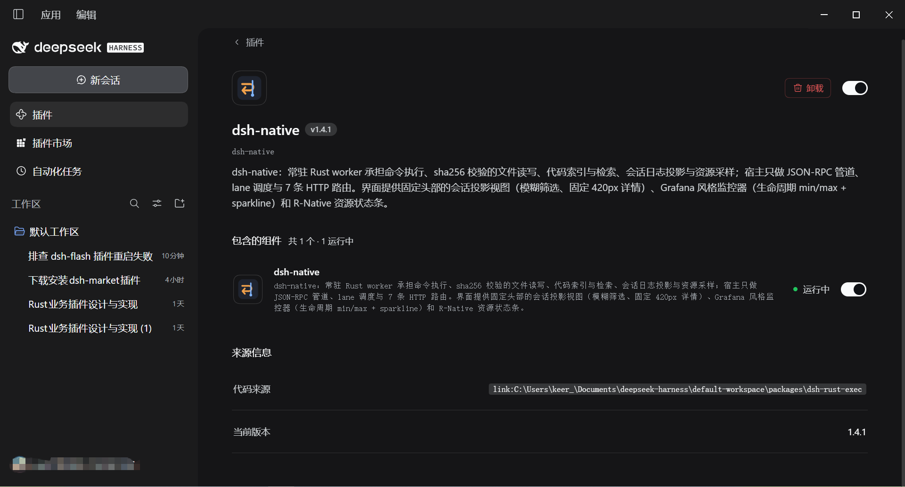
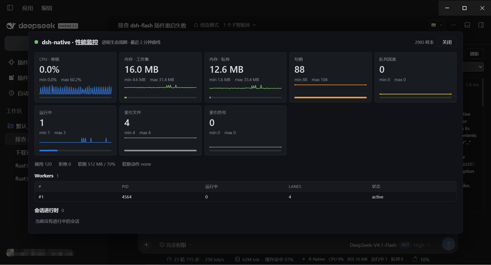

<p align="center">
  
</p>

<h1 align="center"></h1>

<p align="center"><code>a resident Rust sidecar for DeepSeek Harness</code></p>

<p align="center"><sub>warm shell lanes · sha256-guarded file IO · code index &amp; search · session-log projection · resource monitor</sub></p>

<p align="center">
  <a href="#中文">中文</a> | <a href="#english">English</a>
</p>

<p align="center">
  
  
  
  
  
</p>

<hr>

<a id="中文"></a>

把 DSH 里「真正动手」的那部分交给一个**常驻的 Rust worker**：命令执行、带 sha256 校验的文件读写、代码索引与检索、会话日志投影、资源采样都在 Rust 侧完成；DSH 宿主只做 JSON-RPC 管道、lane 调度与路由注册，浏览器侧只做**叠加式**展示。

对外是 **10 个工具 + 7 条 HTTP 路由**，界面是**固定头部的会话投影视图**、**Grafana 风格监控器**和输入框下沿的 **R-Native 资源状态条**。

> 当前版本 **1.5.1**（2026-10-23）。1.4.0 起包名由 `dsh-flash` 改为 `dsh-native`，1.5.0 起以 scope 发布为 `@keer1024/dsh-native`（界面显示名仍是 `dsh-native`）；工具名 `rust_*`、路由前缀 `/api/dsh-rust-exec/*`、worker 镜像名 `dsh-rust-worker.exe` 保持不变，以免破坏既有配置与已装用户。

---

## 1. 为什么需要它


1. **每次工具调用都新起进程太贵。** DSH 每调一次 `pwsh` 要付一次 PowerShell 冷启动
   （本机 2.4–4.4 s，低完整性沙箱下更慢）。这里改成常驻 worker + 常驻 shell server，
   同一 lane 上后续命令是毫秒级。
2. **大输出、大文件、大日志把上下文吃光。** 读文件按行区间、搜索按字节预算裁剪、
   会话日志先解码当前页——同召回下返回体积约降 **80%**。
3. **看不见运行状态。** worker 多少次重启、队列堵没堵、RSS 涨到哪、哪个会话在跑——
   全部进 `/metrics`、`rust_health` 和监控器，不用猜。


<a id="shots"></a>

## 2. 界面速览

<p align="center">
  
  <br>
  <sub><b>① 介绍</b> — 设置页里的插件条目、版本与资源监控入口</sub>
</p>

<p align="center">
  
  <br>
  <sub><b>② 视图页</b> — 固定头部（计数、模糊筛选、类别下拉、监控器/刷新）+ 左侧消息列表 + 固定 420 px 详情</sub>
</p>

<p align="center">
  
  <br>
  <sub><b>③ 监控页</b> — 生命周期 min/max 数字卡片、零依赖 sparkline、worker 表与活动会话表</sub>
</p>

---

## 3. 快速开始

### 3.1 装到 DSH（npm）

```powershell
# 1) 装进 DSH profile
pnpm add @keer1024/dsh-native     # 或 npm i @keer1024/dsh-native

# 2) 挂载 bundle —— 编辑 <DSH_HOME>\profiles\<profile>\package.json
#    "dsh": { "profile": { "bundles": [
#        "@deepseek-ai/dsh-base", "@deepseek-ai/dsh-web-app", "@keer1024/dsh-native" ] } }

# 3) 重启 DSH，然后验收
curl http://127.0.0.1:<port>/api/dsh-rust-exec/health
```

返回里能看到 `ok: true`、worker pid 和 `routes: 7`，就说明装好了；随后设置页 → 插件 → `dsh-native`
会出现「监控器」按钮，对话页顶部会多出「R-Native 视图」页签。

### 3.2 从 tarball 安装（离线 / 内网）

```powershell
npm i E:\path\keer1024-dsh-native-1.5.1.tgz
```

目标机要求、profile 两处改动、SmartScreen 与常见失败见
[分发与跨机安装](docs/rust-exec-plugin/DISTRIBUTION.md)。

### 3.3 开发机自检

```powershell
node tools\check_client_identity.mjs      # 包名 / client 注册 id / patch 名 / files[] 一致性
$env:DSH_PROFILE='desktop'; node tools\live_route_check.mjs   # 线上 7 条路由与工具清单
```

### 3.4 升级与卸载

- **升级**：`pnpm add @keer1024/dsh-native@latest` → 重启 DSH。exe 被占用时先 `Move-Item` 改名为 `.old`
  （Windows 允许重命名运行中的镜像），复制新 exe，再删 `.old`。
- **卸载**：在 DSH 插件管理里移除，或从 `dsh.profile.bundles` 删掉该条目 → 重启 DSH；
  投影缓存可以整体删除，不残留状态。

装好后 host 侧（工具、路由）热生效；客户端叠加物需要**刷新一次页面**。

---

## 4. 设计原则


- **常驻而非按需**：worker 在 `apply()` 时就预热（`pool.start()`），冷启动成本落在 DSH 启动期，
  不落在第一次工具调用上。
- **旁路只读**：会话投影只读 DSH 的 append-only 日志，不接管写路径；停用插件即回到原路径，
  投影缓存可整体删除。
- **叠加不接管**：客户端只往 `settings.plugins.tab` / `conversation.view` /
  `conversation.composer.dock` 三个槽位里加东西，DSH 原生对话渲染不受影响；任一槽位不可用
  只降级、不报错。
- **失败要可诊断**：握手/心跳/重启计数/最后一次退出码/路由挂载结果都在 `rust_health` 与
  `/health` 里，而不是只在控制台打一行日志。


## 5. 架构


```
模型 ──工具调用──▶ dsh-native（host 插件, index.js）
                    │  Content-Length 帧 / JSON-RPC（stdin + stdout）
                    ▼
              dsh-rust-worker.exe（常驻进程，懒启动 + 自愈）
                    ├─ lane 池（默认 4 条）──▶ 常驻 PowerShell shell server
                    │                          （每条 lane 一个 -EncodedCommand 进程）
                    ├─ 文件 IO（sha256 版本守卫 / 原子写）
                    ├─ 代码索引（文件 → 符号，按需重建）
                    ├─ 会话解码（session.v*.jsonl.zstd → 投影）
                    └─ 资源采样（RSS / CPU / 句柄 / 队列 / 调用）
                    ▲
                    └── 每 2 s 心跳；宿主消失 → worker exit(3)
```

| 组件 | 路径 | 说明 |
|---|---|---|
| Rust worker | [`packages/dsh-rust-worker`](packages/dsh-rust-worker) | 常驻进程；预编译产物随包发布为 `bin/dsh-rust-worker.exe`（≈2.25 MB） |
| DSH host 插件 | [`packages/dsh-rust-exec`](packages/dsh-rust-exec) | 10 个工具 + 7 条路由 + `Config` 校验 + 设置页标签页 |
| 浏览器侧叠加物 | [`packages/dsh-rust-exec/client.js`](packages/dsh-rust-exec/client.js) | 设置页与监控器、会话投影视图、`R-Native` 状态条 |
| 生命周期契约 | `index.js` ↔ `main.rs` | 协议版本 1；`hello` 不匹配 exit(2)；宿主看护失败 exit(3) |

**一次工具调用的路径**：`tool call → 会话亲和选 worker → lane 租约（满则排队，超过
`maxQueueDepth` 拒绝）→ 写一帧 JSON-RPC → worker 在该 lane 的常驻 shell 上执行 →
读回 Content-Length 帧 → 渲染器裁剪 → 模型`。同 session 的调用优先落在同一 worker，
同 step 的多个调用可以真并行（lane 数决定上限）。


## 6. 工具参考（10 个）


| 工具 | 作用 | 主要参数 |
|---|---|---|
| `rust_exec` | 在常驻 PowerShell lane 上执行命令；返回 `exitCode/stdout/stderr/ms/shellMs/queueMs/lane/reused` | `command`（必填）、`cwd`（持久化到后续调用）、`timeoutMs`、`queueTimeoutMs`（默认 30000） |
| `rust_read` | 读文件，按行区间取，返回 `sha256` 与总行数；同一文件同一区间的重复读会去重 | `path`、`offset`（1 起）、`limit`、`refresh` |
| `rust_write` | 原子写（临时文件 + rename），可选版本守卫 | `path`、`content`、`expectedHash`（sha256 或 `absent`） |
| `rust_edit` | 精确文本替换，锚点有歧义时失败且不改文件 | `path`、`oldString`、`newString`、`replaceAll` |
| `rust_stat` | 原生 stat：大小、时间、类型 | `path` |
| `rust_ls` | 目录列举，可限条数 | `path`、`limit` |
| `rust_search` | 常驻索引上的文本/正则检索，按字节预算与相关度裁剪 | `query`、`glob`、`regex`、`symbolsOnly`、`contextLines`（0–2）、`maxHits`（默认 24）、`maxBytes`（默认 6000）、`refresh` |
| `rust_symbols` | 符号检索（fn/class/struct/trait…），返回定义位置 | `query`、`path`、`kind`、`limit`（默认 40）、`maxBytes`、`refresh` |
| `rust_session_open` | 直接解 `session.v*.jsonl.zstd`，游标分页，首屏只解码当前页 | `path`、`limit`（1–500，默认 50）、`cursor`、`refresh` |
| `rust_health` | worker 存活、心跳间隙 p50/p99、重启次数、最后退出码、索引规模、路由挂载 | 无 |

统一截断契约：被裁剪的结果在 footer 带 `truncated by lines|bytes · omitted N · complete=false`，
完整结果显示 `complete`，便于模型判断要不要续读。


## 7. HTTP 路由（7 条）


前缀 `/api/dsh-rust-exec`，挂载失败会退避重试（不会「一次失败永久放弃」），挂载结果见
`/health` 的 `routes.registered`。

| 路由 | 返回 |
|---|---|
| `GET /metrics` | 最近采样（1 s 一点，保留 300 点 + 60 个 1 分钟桶）、`pool`（workers/队列/运行中）、`sessions`、`config`，以及 `extremes`：本宿主进程生命周期内的 min/max/last |
| `GET /health` | `hostPid`、worker pid/版本/协议、重启次数、`routes.registered`、锁文件路径 |
| `GET /events` | 近期事件环形缓冲（重启、软限、路由重挂等） |
| `GET /sessions` | 可投影的会话列表（≤50，按 mtime 倒序） |
| `GET /session?id=&limit=&cursor=` | 单个会话的分页投影（`mode=append/warm/head`、耗时分解） |
| `GET /session/body?id=&seqs=&maxChars=` | 指定 seq 的消息正文（text / reasoning / tool-call；最多 40 个 seq，缺 `seqs` → 400） |
| `POST /config` | 热改配置：`workers`、每会话并发、空闲回收、RSS/CPU 软限等（返回生效后的配置） |

浏览器带会话凭据，Node 侧直接 `fetch` 会拿到 401——渲染测试里用「字段形状取自真实响应」的
fixture 兜底。


## 8. 配置


Loader 行的 `config` 由 `Config['~standard'].validate` 校验，非法值直接拒绝挂载；
`POST /config` 可热改一部分（见上）。

| 键 | 范围 / 默认 | 说明 |
|---|---|---|
| `workerPath` | 默认包内 `bin/dsh-rust-worker.exe` | 跨机部署若路径不同必须显式配（见 DISTRIBUTION 的坑） |
| `defaultTimeoutMs` | >0，默认 60000 | 单次调用默认超时 |
| `lanes` | 1–16，默认 `min(4, cores/2)` | 每个 worker 的并行 shell 数 |
| `maxQueueDepth` | 1–4096，默认 64 | 队列闸门；满了返回可重试的拒绝 |
| `metricsIntervalMs` | ≥250，默认 1000 | 采样周期 |
| `maxWorkers` | 1–8，默认 1 | 多进程是隔离手段，不是吞吐手段（每条多付 ~3 s 冷启动） |
| `maxShells` | 1–64，默认 8 | worker 侧 shell 硬上限 |
| `maxInFlightPerSession` | 1–64，默认 = `lanes` | 同会话并发闸门 |
| `idleReapMs` | ≥10000，默认 300000 | 空闲回收 |
| `rssSoftLimitMb` | 64–65536，默认 512 | 软限：超限先丢索引，不杀进程 |
| `cpuSoftLimitPct` | 10–100，默认 70 | 持续超限时暂停派发 |

环境变量：`DSH_HOME`（锁文件与缓存的根，默认 `%USERPROFILE%\.dsh`）、`DSH_PROFILE`
（锁文件名后缀，默认 `default`）、`DSH_RUST_WORKER_CWD`（worker 的 cwd）、`DSH_RUST_DEBUG`
（协议调试日志）、`DSH_VERSION`（上报用）。测试脚本另认 `DSH_RUST_WORKER` 指定 exe 路径。

锁文件：`<DSH_HOME>/run/dsh-rust-worker-<profile>.lock`，内容两行 `pid` + 宿主实例 UUID。
**由宿主写**（低完整性 worker 写不了），回收前会核对进程镜像名，绝不按 pid 盲杀。

**1.6.1 起不再从带标签的镜像启动**：DSH 沙箱会给工作区里的 exe 打 `Low Mandatory Level`
标签，而 Windows 按**文件**标签（不是父进程）决定进程完整性 —— 低完整性 worker 能读能算，
但写用户文件一律 `拒绝访问 (os error 5)`。插件启动前用 `icacls` 读标签，判定为 `low` 时把
exe 复制到 `%LOCALAPPDATA%\dsh-native\bin\dsh-rust-worker-<size>-<mtime>.exe`（副本无标签，
按宿主完整性运行）再拉起；装在工作区之外、本来就没标签的镜像保持原样。

诊断日志：`%LOCALAPPDATA%\dsh-native\logs\rust-exec-<宿主 pid>.log`（JSONL，2 MB 轮转到 `.1`），
记录 `plugin.mounted` / `worker.relocated` / `worker.spawn` / `worker.ready` / `worker.exit` /
`worker.restart-scheduled` / `tool.error` / `tool.slow`。`rust_health` 与 `/health` 回报
`workerPath`、`relocated`、`integrity`、`logPath`、`recentErrors`，写失败时错误里直接附带
worker 镜像、完整性判定和日志路径。


## 9. 界面细节


### 9.1 设置页 → 插件 → `dsh-native`

顶部只有两个按钮：**刷新**（重新拉一次 `/metrics`）与 **监控器**。

**监控器**（Grafana 风格浮层，`Esc` 或点遮罩关闭）：

- 8 张数字卡片：CPU 单核占用、工作集、私有字节、句柄、队列深度、运行中、索引文件数、索引符号数。
- 每张卡：当前值大字 + 本宿主进程生命周期内的 **min / max** + 120 点零依赖 SVG sparkline，
  有软限的指标再加一条用量条。
- 下方 Workers 表（pid、inflight/lanes、retiring、状态点）与活动会话表
  （sessionId、inflight、calls、lastCallMs、最近活动）。
- `extremes` 由宿主在内存里累计：**DSH 重启清零，刷新页面不丢**。

### 9.2 会话投影视图（`conversation.view`）

- **顶部栏固定**：消息数 / 工具调用数、mode 与耗时、模糊搜索、类别下拉、工具名下拉、刷新、监控器。
- **只有两个区域滚动**：左侧消息列表、右侧详情；外层不产生滚动条。视图会测量 DSH 共享
  scrollport（`[data-conversation-scroll]`）的可见高度，减去内边距、自身布局偏移（与
  `scrollTop` 无关）和悬浮输入区（`[data-composer-seat]`，回退 `--dsh-composer-height`），
  把根节点钉成像素高度——这是 DSH 强制 `flex:1 0 auto; min-height:auto` 之后唯一可靠的做法。
- **模糊筛选**：大小写不敏感的子序列匹配，作用于 `preview / name / kind / seq`，命中片段
  `<mark>` 高亮，显示 `filtered / total`；空结果给空态提示。
- **类别筛选**：单个下拉（`全部类别` + 数据里出现过的 kind）。已知四类固定顺序
  系统 → 用户 → 助手 → 工具，未来 DSH 新增的 kind 自动进下拉并按字母序排后面——不需要改代码，
  也不会像按钮组那样把固定头部撑高。工具名二级下拉最多 20 项。
- **详情**：固定 **420 px**、不可拖拽；加载完成后自动选中第一条（过滤后）消息；内容超出时
  在详情内部滚动；容器窄于 720 px 时降级为上下堆叠。
- 列表是 windowed 渲染（46 px 行高 + overscan），400 行也不卡。

### 9.3 状态条（`conversation.composer.dock`）

标签 **`R-Native`**，指标用 `标签: 数值` 加 ` - ` 分隔：

```
● R-Native  CPU:  0%  -  RSS: 26M  -  运行中: 1  -  队列: 0
```

`title` 为 `R-Native · dsh-native 实时资源`。采样失败时保留上一次值，不闪 `NaN`。

数值用等宽数字（`tabular-nums` / `"tnum"`）并各自占一个**固定 `ch` 宽度的右对齐槽位**
（CPU `4ch`、RSS `5ch`、运行中 `2ch`、队列 `2ch`）。只开等宽数字不够：`0% → 100%`、`9M →
1024M` 会改变字符串长度，居中的整行就会被推着左右跳；定宽槽位让数值变化时状态条纹丝不动。


## 10. 性能（本机实测）


| 场景 | 结果 | 口径 |
|---|---|---|
| 单条命令（常驻 lane vs 新起 `pwsh`） | 4387 ms → **32 ms**（≈137×）；近期 `worker_test` 29.6 ms vs 2899 ms（98×） | 本机 2026-10-21/22，含 PowerShell 冷启动 |
| `rust_search` / `rust_symbols` 同召回返回体积 | **−80%** | 同一查询、同一命中集 |
| 5.5 MB 会话首屏（head 模式） | 1069 ms → **34.2 ms** | 只解码当前页 |
| `session.body` 一页正文 | 15–25 ms | 三帧 decode/parse/read |
| worker 握手 | ~11 ms | hello + initialize |

注意：**新建** PowerShell 进程在本机要 3–20 s（Defender + 模块首次加载，低完整性进程更慢）。
插件在 `apply()` 预热，所以这笔钱通常已经付在 DSH 启动期；若你看到「第一次 `rust_exec` 很慢、
之后很快」，那不是回归。


## 11. 运维与排障


| 症状 | 原因 | 处理 |
|---|---|---|
| 重启后报 `web boot: 1 entry did not activate` / `duplicate factory registration` | `package.json` 的 `name` 与 `client.js` 注册 id、`cordis.patch.yml` 不一致 | `node tools\check_client_identity.mjs` 定位；三处必须同名 |
| 工具列表里没有 `rust_*` | profile 的 `dsh.profile.bundles` 缺 `@keer1024/dsh-native`（只写 `dependencies` 不够） | 补 bundles + `pnpm install` + 重启 |
| 面板 401 / 404 | 浏览器没带凭据，或路由没挂上 | 看 `/health` 的 `routes.registered`；404 会退避重挂 |
| 工具报 `拒绝访问 (os error 5)` 写 `%TEMP%` / `~/.dsh` | 旧版（≤1.6.0）worker 是低完整性进程；1.6.1 已把镜像搬到 `%LOCALAPPDATA%\dsh-native\bin` 再启动 | 先看错误里的 `[dsh-native]` 提示与 `rust_health.logPath`；仍拒绝则多半是 deny ACE / 只读 / 文件被占用 |
| 首次 `exec` 3–20 s | PowerShell 进程冷启动 | 正常；已在启动期预热 |
| 强杀 worker 后残留 `powershell.exe` | Windows 不杀进程树 | `kill()` 用 `taskkill /T`；新 worker 启动时再扫一遍死父进程的 shell |
| 状态条/视图不更新 | 页面还是旧 client bundle | 刷新页面；仍不行则重启 DSH |


## 12. 测试与验收


所有脚本在仓库根目录跑（PowerShell 5.1 + Node ≥22）：

```powershell
node tools\check_client_identity.mjs             # 20 项：客户端 id 与包名一致（防重启失败）
node tools\worker_test.mjs                       # 15 项：协议、持久 shell、exit code、fs/sha256
node tools\lifecycle_test.mjs                    # 10 项：强杀恢复、冻结、陈旧实例回收
node tools\reap_guard_test.mjs                   # 7 项：锁文件不误杀宿主/父进程/无关 pid
node tools\sweep_test.mjs                        # 3 项：孤儿 PowerShell 清扫
node tools\pool_test.mjs                         # 10 项：热扩缩、公平、软限、拒绝
node tools\route_retry_test.mjs                  # 路由退避挂载（7 条）
node tools\panel_render_test.mjs                 # 设置页渲染 + Apply 热配置
node tools\projection_render_test.mjs            # 固定头部、筛选、420px 详情、windowed
node tools\monitor_render_test.mjs               # 监控器 min/max 卡片、sparkline、workers/会话表、状态条
node tools\head_open_test.mjs                    # 会话首屏 head 模式
node tools\session_probe.mjs                     # 会话投影冷/热/分页实测
node tools\p2_bench.mjs                          # 同召回 token 降幅
node tools\verify_low_il_fix.mjs                 # 2 项：带 Low 标签的原镜像写拒绝 / 搬迁副本写成功
node tools\plugin_worker_probe.mjs               # 1 项：直接拉起部署版 RustWorker，验证 relocated + 写工作区
```

最近一次全量（2026-10-22）：identity 20/20、worker 15/15、lifecycle 10/10、pool 10/10、
reap 7/7、sweep 3/3，渲染与路由脚本全绿。


## 13. 兼容性与限制


- **平台**：仅 Windows 10/11 x64（worker 用 `OpenProcess` 看护宿主、`powershell.exe` 作 shell、
  文件路径按 Windows 语义）。macOS/Linux 需要另出二进制。
- **DSH**：实测 0.2.1-rc.2 / Electron 44 / Node 24；DSH 仍在 rc，插件契约可能变。
- **Node**：host 插件只用 `node:` 内置模块，≥22 即可。
- **只读投影**：真相源仍是 DSH 会话日志，插件不写回；投影可丢弃可重建。
- **低完整性**：1.6.1 起 worker 从 `%LOCALAPPDATA%\dsh-native\bin` 的副本启动，不再继承 DSH
  给工作区镜像打的 Low IL 标签；若某台机器的策略把副本也打了标，日志与错误提示会指名道姓
  报出来（见排障表）。
- **分发状态**：包名 `@keer1024/dsh-native`，npm 上尚未上架（已登录 `keer1024`，发布卡在 2FA）；
  当前通过 tarball / 目录 link 分发，步骤见 [DISTRIBUTION.md](docs/rust-exec-plugin/DISTRIBUTION.md)。


## 14. 目录结构


```
packages/dsh-rust-exec/      host 插件 + 客户端叠加物 + 预编译 worker
  index.js                   Config / RustWorker / WorkerPool / MetricsStore / 10 工具 / 7 路由
  client.js                  设置页、监控器、会话视图、状态条（React，零依赖）
  cordis.patch.yml           bundle patch（insert dsh-native）
  locale/{zh,en}.json        meta.title / meta.description
  bin/dsh-rust-worker.exe    预编译 worker（随包发布）
packages/dsh-rust-worker/    Rust 源码（main.rs / index.rs / session.rs / metrics.rs）
tools/                       验收与基准脚本
docs/rust-exec-plugin/       设计、实测、发布、分发文档
dist/                        打包产物（tarball + sha256）
```


## 15. 文档与许可

- 完整文档索引见下；历史设计/实验记录在 [docs/rust-exec-plugin](docs/rust-exec-plugin/)。
- 分发与跨机安装：[DISTRIBUTION.md](docs/rust-exec-plugin/DISTRIBUTION.md)
- 与 dsh-ops 的能力对比：[DSH_OPS_COMPARISON.md](docs/rust-exec-plugin/DSH_OPS_COMPARISON.md)
- 发布到 npm / 插件市场：[PUBLISHING.md](docs/rust-exec-plugin/PUBLISHING.md)
- 变更记录：[CHANGELOG.md](packages/dsh-rust-exec/CHANGELOG.md)
- 许可证：[MIT](packages/dsh-rust-exec/LICENSE)

<a id="english"></a>

---

## English

**dsh-native** is a resident Rust sidecar for [DeepSeek Harness](https://github.com/deepseek-ai). Command execution, sha256-guarded file IO, code indexing/search, session-log projection and resource sampling all run in a long-lived Rust worker; the host stays a thin JSON-RPC / lane-scheduling / route layer.

- **10 tools** — `rust_exec`, `rust_read`, `rust_write`, `rust_edit`, `rust_stat`, `rust_ls`, `rust_search`, `rust_symbols`, `rust_session_open`, `rust_health`
- **7 routes** — `/api/dsh-rust-exec/{metrics,health,events,sessions,session,session/body,config}`
- **UI** — pinned-header projection view (fuzzy filter, fixed 420 px detail), Grafana-style monitor (lifecycle min/max + sparkline), `R-Native` resource strip
- **Install** — `pnpm add @keer1024/dsh-native`, add `@keer1024/dsh-native` to `dsh.profile.bundles`, restart DSH
- **Requires** — Windows 10/11 x64 · DSH desktop · PowerShell 5.1 (no Node.js on the target machine)

See the Chinese sections above for the full manual, or read [CHANGELOG.md](packages/dsh-rust-exec/CHANGELOG.md).
